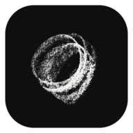
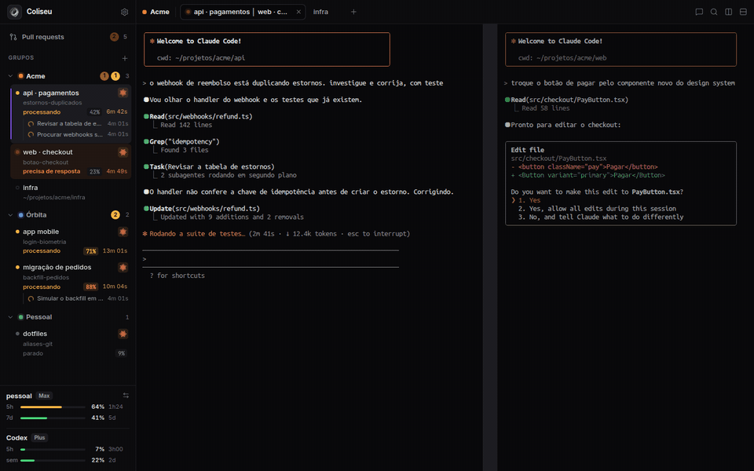
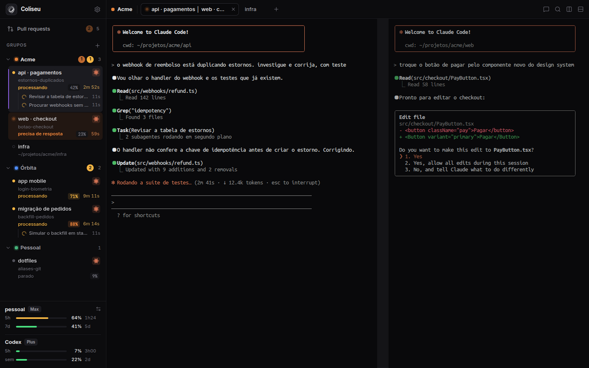
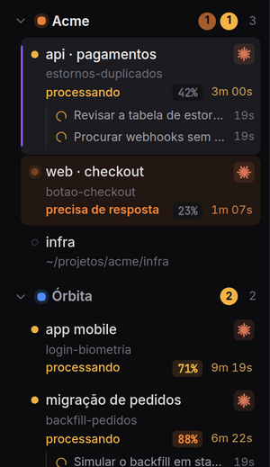
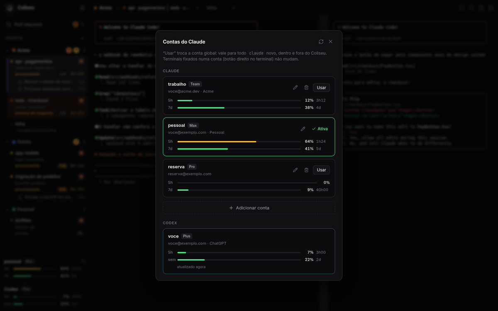
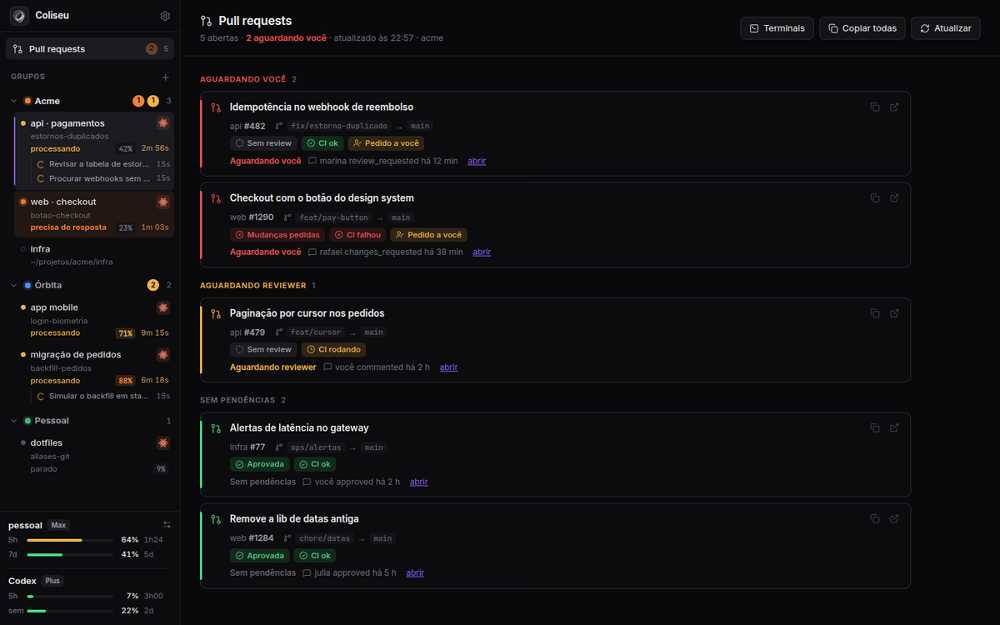
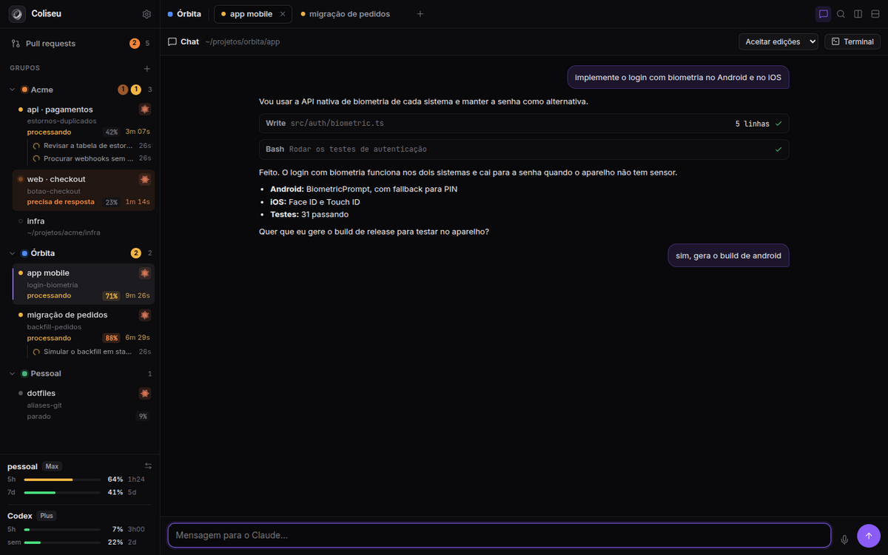
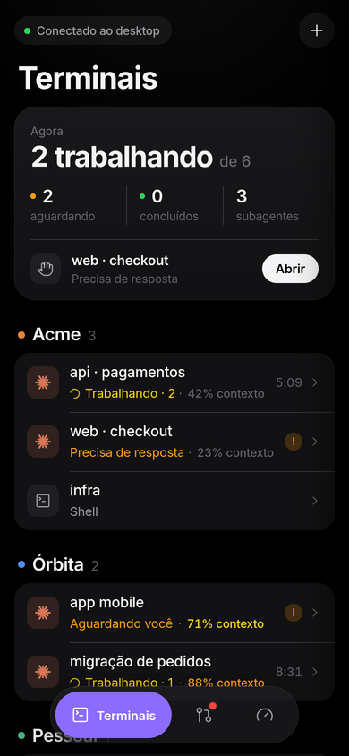
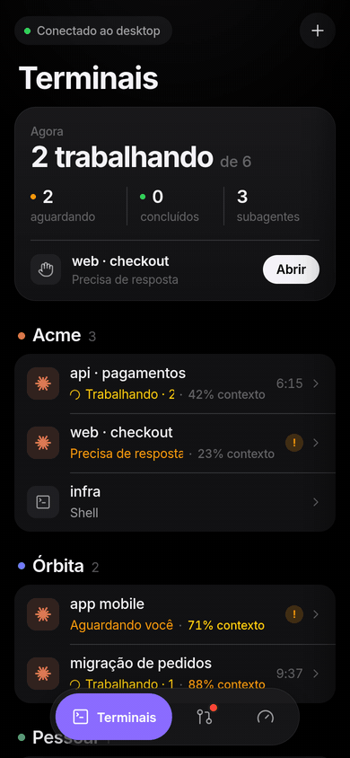
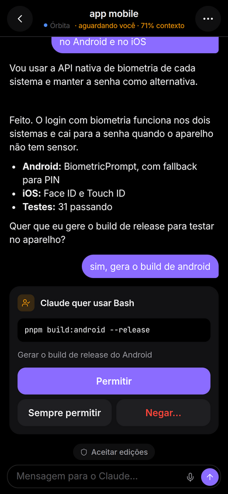

<p align="center">
  
</p>

<h1 align="center">coliseu</h1>

<p align="center">
  <b>Seus agentes de código, numa arena só.</b><br>
  Um terminal para quem roda várias sessões do Claude Code e do Codex ao mesmo tempo.<br>
  Organiza tudo por projeto, avisa quando um agente precisa de você e deixa você responder pelo celular.
</p>

<p align="center">
  
</p>

---

## Por que existe

Com vários agentes rodando em paralelo, o gargalo passa a ser você. Um deles parou há vinte
minutos esperando uma permissão, e você só descobre quando passa por aquela aba.

O Coliseu junta todas as sessões num lugar e mostra, o tempo todo, qual está **trabalhando**,
qual está **aguardando você** e qual **terminou**. Sem instalar hooks no seu Claude e sem
servidor na nuvem: ele lê os arquivos que o Claude Code já grava e deixa as sessões com o tmux.

## O que ele faz

**Organização**
- Grupos por empresa ou projeto, cada um com suas abas e telas lado a lado.
- Cada terminal é um shell de verdade (PTY real, seu shell de login, suas permissões).
- As sessões rodam num tmux próprio: fechou o app, ele travou ou foi atualizado, ao abrir está tudo lá.
- Depois de reiniciar o PC, os terminais voltam com o histórico e o Claude é retomado com `claude --resume`.

**Agentes**
- Estado de cada sessão do Claude Code e do Codex: trabalhando, aguardando você (permissão ou pergunta), concluído.
- Subagentes em andamento aparecem embaixo da sessão principal.
- **Contexto em uso** de cada sessão, o mesmo número do `/context`, que muda de cor a partir de 70% e 85%.
- Comando em segundo plano: quando o Claude terminou mas deixou um comando rodando, a sessão aparece como parada, com a marca "2º plano".

**Notificações**
- "Aguardando você" na hora; "concluiu" só quando a sessão principal termina (não a cada subagente).
- Clicar na notificação traz o Coliseu para a frente, no terminal certo.
- Grupos silenciados, som e aviso só com o app fora de foco são configuráveis.

**Contas do Claude**
- Várias contas: troque a conta global num clique ou fixe uma conta por terminal.
- Uso de 5 horas e de 7 dias de cada conta à vista, com a conta ativa destacada.
- Uso da conta do Codex também aparece.

**Modo chat**
- Abra qualquer sessão do Claude como chat, com o mesmo histórico e o mesmo modo de permissão do terminal.
- Pedidos de permissão, perguntas e planos viram cartões com botões; volte ao terminal quando quiser.
- Ditado por voz: no PC, um botão usa o `/voice` do próprio Claude Code; no celular, o reconhecimento de voz do navegador (o texto fica no campo para você revisar).

**Pull requests**
- Suas PRs abertas no GitHub num painel, separadas entre "aguardando você", "aguardando reviewer" e "sem pendências", com status de revisão e de CI.

**Celular**
- Um app (PWA) que conversa direto com o Coliseu do seu PC pela sua rede privada do Tailscale.
- Início com quem trabalha, quem espera e o que terminou; conversas abrem no chat.
- Notificações push direto do seu PC; tocar abre a conversa certa.
- Se o PC não responder, uma tela explica o que conferir e reconecta sozinha.

## Prints

| Visão geral | Estado e contexto |
|---|---|
|  |  |

| Contas do Claude | Pull requests |
|---|---|
|  |  |

| Modo chat no desktop |
|---|
|  |

<p align="center">
  
  &nbsp;
  
  &nbsp;
  
</p>

> Os prints vêm de uma instância de demonstração com dados de exemplo. As ferramentas que geram
> esses prints estão no repositório do site.

## Requisitos

- **Linux** (testado no Ubuntu com X11). macOS e Windows ainda não são suportados.
- **tmux**.
- **Rust** (via [rustup](https://rustup.rs)) e as dependências de sistema do Tauri 2.
- **Node.js** 20+ e **pnpm**.
- **Claude Code** e/ou **Codex** instalados (é o que o Coliseu organiza).

Opcionais:

| Para | Precisa de |
|---|---|
| Modo chat | Node.js no `PATH` do shell de login (o chat roda o Claude Agent SDK num processo auxiliar) |
| Painel de PRs | [GitHub CLI](https://cli.github.com) (`gh`) autenticado |
| Clicar na notificação e o app vir para a frente (X11) | `xdotool` |
| Ditado no PC | `arecord` (alsa-utils) ou SoX, e login no Claude Code com uma conta Claude.ai |
| Usar pelo celular | [Tailscale](https://tailscale.com) no PC e no celular |

## Instalação

```bash
# 1. Dependências de sistema (Ubuntu/Debian)
sudo apt install tmux build-essential curl wget file libssl-dev \
  libwebkit2gtk-4.1-dev libayatana-appindicator3-dev librsvg2-dev libxdo-dev xdotool

# 2. Código e dependências
git clone https://github.com/kaleben/coliseu
cd coliseu
pnpm install
pnpm --dir sidecar install     # modo chat

# 3. Compilar
pnpm tauri build
```

O build gera o executável em `src-tauri/target/release/coliseu` e os pacotes `.deb` e
`.AppImage` em `src-tauri/target/release/bundle/`. Para instalar pelo pacote:

```bash
sudo apt install ./src-tauri/target/release/bundle/deb/Coliseu_*.deb
```

Só quer o executável, sem gerar pacotes? Use `pnpm tauri build --no-bundle`.

### Usar pelo celular (opcional)

1. Instale o [Tailscale](https://tailscale.com/download) no PC e no celular, na mesma conta.
2. No painel da sua tailnet, em **DNS**, ligue **MagicDNS** e **HTTPS Certificates**.
3. No PC, deixe o seu usuário pedir certificados sem sudo:
   ```bash
   sudo tailscale up
   sudo tailscale set --operator=$USER
   ```
4. No Coliseu: **Configurações → Acesso remoto** → ligar. Abra o QR code no celular.
5. No celular, instale o app pela opção "Adicionar à tela inicial" e ative as notificações.

O HTTPS (certificado do próprio Tailscale, renovado sozinho) é o que libera as notificações,
o ditado e a instalação como app. O acesso é protegido por um token, que pode ser trocado a
qualquer momento nas configurações (os celulares conectados precisam do link novo).

## Uso

### Atalhos

| Atalho | Ação |
|---|---|
| `Ctrl+Shift+T` | Novo terminal no grupo atual |
| `Ctrl+Shift+D` | Dividir lado a lado |
| `Ctrl+Shift+E` | Dividir em cima/baixo |
| `Ctrl+Shift+W` | Fechar o terminal |
| `Ctrl+Shift+R` | Renomear o terminal |
| `Ctrl+Shift+F` | Buscar no terminal |
| `Ctrl+Shift+C` / `Ctrl+Shift+V` | Copiar / colar |
| `Ctrl+Shift+P` | Pull requests ⇄ terminais |
| `Ctrl+PageUp` / `Ctrl+PageDown` | Aba anterior / próxima |
| `Alt+1` … `Alt+9` | Ir para o grupo 1…9 |
| `Alt+←` `Alt+→` | Painel anterior / próximo |
| `Alt+K` | Ditado por voz no terminal do Claude (depois de configurar, veja abaixo) |

Dois cliques no nome de um terminal também renomeiam; o botão do meio fecha a aba.

### Ditado no PC

O botão de microfone usa o `/voice` do Claude Code em modo *tap* (um toque começa, outro para
e envia). Para ligar, adicione ao `~/.claude/settings.json`:

```json
"voiceEnabled": true,
"voice": { "enabled": true, "mode": "tap" }
```

e ao `~/.claude/keybindings.json`, no contexto `Chat`:

```json
"meta+k": "voice:pushToTalk"
```

### Contas do Claude

Em **Contas** (rodapé da lateral) você adiciona contas pelo login oficial da Anthropic, dá um
apelido a cada uma e escolhe a ativa. "Usar" troca a conta global: vale para todo `claude` novo,
dentro e fora do Coliseu. Com o botão direito num terminal, você fixa uma conta só para ele.

## Como funciona

```
┌──────────────── Interface (TypeScript + xterm.js) ─────────────────┐
│  lateral: grupos ▸ terminais ▸ subagentes   │  abas e divisões     │
│  rodapé: conta ativa + uso                  │  terminal ⇄ chat     │
└───────────────▲─────────────────────────────────────▲──────────────┘
                │ IPC do Tauri (desktop)              │ WebSocket (celular)
┌───────────────┴──────────── Núcleo (Rust) ──────────┴──────────────┐
│ tmux · PTY · estado dos agentes · contexto · contas · PRs          │
│ notificações · servidor HTTPS do celular · Web Push                │
└──────┬──────────────────────────────────────┬──────────────────────┘
       │                                      │
 tmux -L coliseu ─► shell de login ─► claude / codex     sidecar Node (Agent SDK, modo chat)
```

- **Tauri 2 + Rust** no núcleo, **TypeScript puro + Vite** na interface (sem framework), **xterm.js** no terminal.
- **tmux** em socket próprio (`tmux -L coliseu`), sem barra, sem prefixo e sem atalhos: é só o motor que mantém as sessões vivas. Não mexe no seu tmux.
- **Estado dos agentes** sem hooks: lê `~/.claude/sessions/*.json`, as transcrições em `~/.claude/projects/` e, no Codex, o título do terminal e `~/.codex/session_index.jsonl`.
- **Contexto em uso**: tokens da última resposta da sessão principal (entrada + cache + saída) sobre a janela do modelo, lidos de forma incremental.
- **Modo chat**: um processo Node auxiliar (`sidecar/agent.mjs`) roda o Claude Agent SDK retomando a mesma sessão do terminal.
- **Celular**: o mesmo núcleo serve a interface por HTTPS na rede do Tailscale e envia notificações por Web Push (VAPID), sem servidor de terceiros.

Especificações detalhadas em [`docs/`](docs/): [modo chat](docs/CHAT_SPEC.md),
[app do celular](docs/MOBILE_SPEC.md) e [notificações](docs/NOTIFY_SPEC.md).

## Onde ficam os dados

| Caminho | O que é |
|---|---|
| `~/.config/coliseu/config.json` | Grupos, terminais, layout, preferências e acesso remoto |
| `~/.config/coliseu/tmux.conf` | Config do tmux do Coliseu (gerada a cada abertura) |
| `~/.local/share/coliseu/profiles/` | Contas do Claude (credenciais de cada conta) |
| `~/.local/share/coliseu/snapshots/` | Histórico salvo para restaurar depois de reiniciar o PC |
| `~/.local/share/coliseu/tls/` | Certificado HTTPS do Tailscale (chave com permissão 600) |
| `~/.local/share/coliseu/push/` | Chaves VAPID e celulares inscritos nas notificações |
| `~/.local/share/coliseu/models.json` | Janela de contexto aprendida de cada modelo |

O Coliseu não envia nada para fora da sua máquina, exceto as chamadas que você mesmo faria:
login e consulta de uso das contas da Anthropic, a API do GitHub (pelo `gh`) e as
notificações push para o seu celular.

## Desenvolvimento

```bash
pnpm install && pnpm --dir sidecar install
pnpm tauri dev                          # app com recarga automática
cd src-tauri && cargo test              # testes do núcleo
pnpm build                              # checagem de tipos + build da interface
```

Para testar sem mexer na instância que você usa no dia a dia, rode com um perfil separado:

```bash
COLISEU_PROFILE=dev pnpm tauri dev
```

O perfil isola a config (`~/.config/coliseu-dev/`), o socket do tmux (`coliseu-dev`), os
snapshots e as inscrições de push. Na porta do acesso remoto, use uma diferente da instância
principal.

Estrutura:

```
src/              interface (main.ts, pane.ts, chat.ts, settings.ts…)
src/mobile/       app do celular (início, conversa, contas, PRs)
src-tauri/src/    núcleo em Rust (tmux, agents, context, accounts, chat, remote, push…)
sidecar/          processo do modo chat (Claude Agent SDK)
public/           PWA: manifesto, ícones, service worker, tela sem conexão
docs/             especificações e mídia do README
```

## Limitações conhecidas

- Só Linux por enquanto.
- O modo chat funciona só com o Claude; o Codex aparece com estado e uso da conta, mas no terminal.
- O botão de ditado no PC depende do `/voice` do Claude Code e só aparece no app do PC.
- Trazer a janela para a frente ao clicar numa notificação usa o `xdotool` (X11); fora do X11, depende do ambiente gráfico.

## Contribuindo

Issues e pull requests são bem-vindos. Antes de um PR grande, abra uma issue para conversar
sobre a ideia. Mantenha o espírito do projeto: leve, sem hooks no Claude, sem servidor externo.

## Licença

[MIT](LICENSE).
